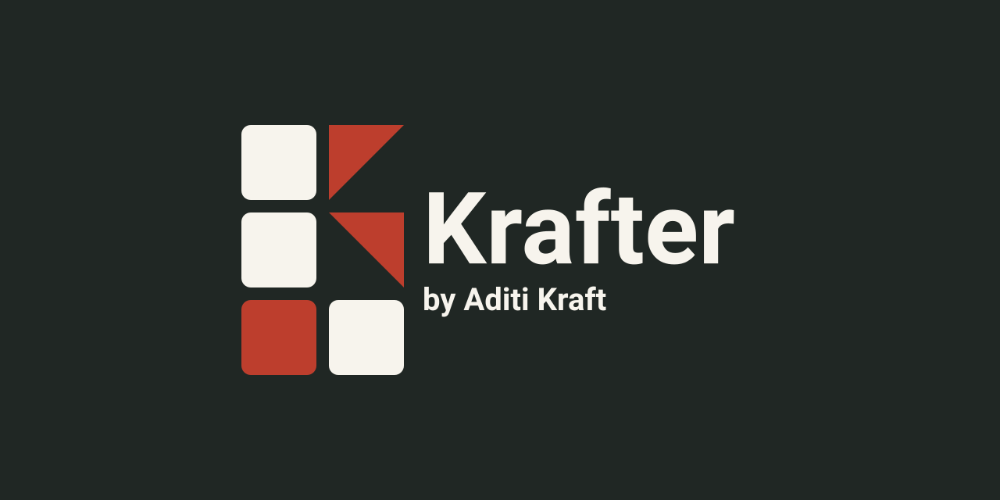
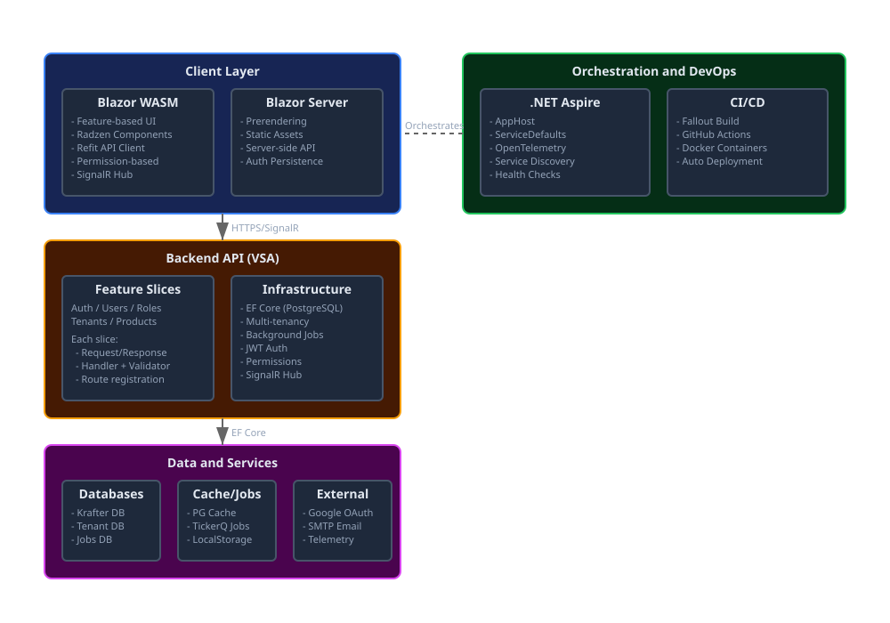
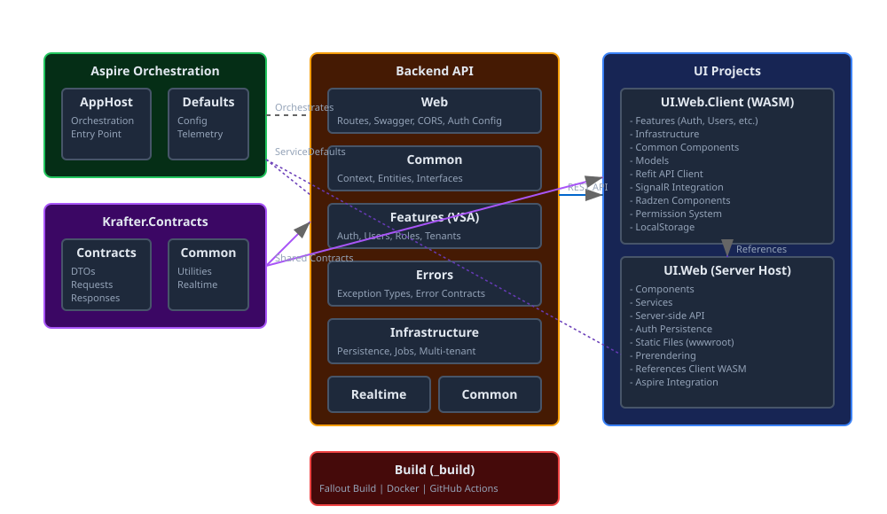

# Krafter

<p align="center">
  
</p>

> A modern .NET 10 full-stack **project template** for building multi-tenant SaaS applications with Vertical Slice Architecture (VSA), Hybrid Blazor, and AI-friendly structure.

[](https://dotnet.microsoft.com/)
[](https://dotnet.microsoft.com/apps/aspnet/web-apps/blazor)
[](LICENSE)

## ⚡ Start Here — Install the Template, Then Create Your App

> **Krafter is used via `dotnet new`.**
>
> You do **not** clone this repository to start an application.
> Clone it only if you want to [contribute to the template itself](#-contributing--template-development).

```bash
# 1. Install the template pack (one-time)
dotnet new install AditiKraft.Krafter.Templates

# 2. Create a new app
dotnet new krafter -n MyApp            # Split Host (separate API + UI)
dotnet new krafter-single -n MyApp     # Single Host (combined)

# 3. Run it
cd MyApp
dotnet run --project aspire/MyApp.Aspire.AppHost/MyApp.Aspire.AppHost.csproj
```

### Template Variants

Krafter ships as a `dotnet new` template pack with two hosting models:

| Template | Command | Best for |
|----------|---------|----------|
| **Split Host** | `dotnet new krafter -n MyApp` | Separate Backend API + Blazor UI, clearer service boundaries, independent scaling |
| **Single Host** | `dotnet new krafter-single -n MyApp` | Combined API + UI, simpler deployment, fewer moving parts |

> Always use `-n` to set your project name — it replaces namespaces, folders, and project files throughout the generated solution.

<details>
<summary><strong>When should I choose each variant?</strong></summary>

**Choose Split Host (`krafter`) when:**
- You want to scale API and UI independently
- Different teams own backend vs frontend
- You expect additional clients such as mobile apps or CLIs
- You prefer explicit service boundaries

**Choose Single Host (`krafter-single`) when:**
- You want the simplest possible deployment
- You prefer a single process and a single Aspire resource
- You want lower operational overhead
- Your team owns the full stack end to end

</details>

### Manage the Template

```bash
dotnet new install AditiKraft.Krafter.Templates   # Install
dotnet new update                                  # Update to latest
dotnet new uninstall AditiKraft.Krafter.Templates  # Uninstall
```

## 🚀 Demo

Try the live demo at [https://krafter.getkrafter.dev/](https://krafter.getkrafter.dev/)

**Default Credentials:**
- Email: `admin@example.com`
- Password: `123Pa$$word!`

Alternatively, log in with Google to create a new account.

> [!IMPORTANT]
> **The root tenant's identifier is `root`, but its address comes from `Urls:RootUiUrl`.**
> With `RootUiUrl=https://krafter.getkrafter.dev` and `TenantBaseDomain=getkrafter.dev`, open `krafter.getkrafter.dev` for the root tenant. `root.getkrafter.dev` is not an automatic alias and returns "Tenant not found". Regular tenants, such as `blue`, use `blue.getkrafter.dev` once created.
> See [Root tenant address](docs/url-configuration.md#root-tenant-address) for details.

## 🎯 What Krafter Gives You

Krafter is a **production-ready .NET 10 application template**, not a starter toy project. It gives you a structured foundation for full-stack business apps with modern defaults already wired together.

### Included out of the box

| Area | What you get |
|------|--------------|
| **Architecture** | Vertical Slice Architecture (VSA), feature-based organization, Minimal APIs, clean separation between Contracts, Backend, and UI |
| **Frontend** | Hybrid Blazor (WebAssembly + Server), Radzen UI components, code-behind pattern, responsive layouts, theming support |
| **Security** | JWT authentication, Google OAuth, permission-based authorization, token refresh, ASP.NET Core Identity |
| **Multi-tenancy** | Tenant-aware design with database-level isolation patterns |
| **Data** | Entity Framework Core 10, PostgreSQL, migrations, soft delete, multiple database contexts (historical queries are not supported) |
| **Realtime & jobs** | SignalR for live updates, TickerQ for background processing |
| **API consumption** | Refit-based type-safe HTTP clients with token handling |
| **Observability** | .NET Aspire, OpenTelemetry, health checks, structured logging |
| **Delivery** | Docker support, Fallout build automation, GitHub Actions workflows |

### Why teams choose it

- **Template-first workflow** with `dotnet new`
- **Feature-oriented backend structure** that is easier to extend with AI assistance
- **Modern full-stack .NET setup** without spending days on wiring
- **Two hosting models** so you can optimize for simplicity or separation
- **Built-in patterns** for auth, tenants, jobs, realtime, and observability

## 🏛️ Architecture

The diagrams below reflect the template structure and are useful before you generate or contribute to a project.

### Solution Architecture Diagram



### Project Dependencies Diagram



## 🚀 Getting Started

> This section applies to a **generated project** created with `dotnet new krafter` or `dotnet new krafter-single`.
>
> If you want to work on the template repository itself, jump to [Contributing & Template Development](#-contributing--template-development).

### Prerequisites

- [.NET 10 SDK](https://dotnet.microsoft.com/download/dotnet/10.0)
- [Docker Desktop](https://www.docker.com/products/docker-desktop) (for Aspire/PostgreSQL)
- [Visual Studio 2022 17.11+](https://visualstudio.microsoft.com/) or [VS Code](https://code.visualstudio.com/)

### First Run

1. Create a project from the template
   ```bash
   dotnet new krafter -n MyApp
   cd MyApp
   ```

2. Start the AppHost
   ```bash
   dotnet run --project aspire/MyApp.Aspire.AppHost/MyApp.Aspire.AppHost.csproj
   ```

3. Let `myapp-migrator` finish before judging startup health
   - The AppHost starts the short-lived migrator before the main app resources
   - For normal startup, you do **not** need to run `dotnet ef database update` manually

4. Open the generated app
   - **Aspire Dashboard**: https://localhost:17285
   - **Backend API** (split host only): https://localhost:5199
   - **Scalar API Reference** (split host only): https://localhost:5199/scalar/v1
   - **Blazor UI**: https://localhost:7291

5. In Development, sign in with the seeded admin account
   - Email: `admin@example.com`
   - Password: `123Pa$$word!`

   Alternatively, log in with Google, which will create a new account.

Backend startup provisions the root account before serving requests in both hosting variants. For a fresh database outside Development, supply a private `Bootstrap:RootPassword` setting (environment variable `Bootstrap__RootPassword`) to the Backend host in split mode or the combined UI host in single mode. It must satisfy the configured Identity password rules, fit the shared login password length limit, and differ from the public Development password above; missing or invalid configuration stops startup without creating identity data. Supply it through your deployment secret configuration, and remove it after successful initial provisioning if desired.

Bootstrap runs only when that tenant has no user or role history, including soft-deleted records. Existing identities, passwords, role memberships, and removed permissions remain unchanged on restart; partial or deleted identity data requires deliberate operator recovery. New tenants are still provisioned by the authorized tenant-creation operation, with their welcome email queued after identity data commits. There is no HTTP seeding endpoint or UI-triggered seeding.

<details>
<summary><strong>Database migrations workflow</strong></summary>

AppHost applies checked-in migrations automatically through `krafter-migrator`. In normal local development, start AppHost and let the migrator complete.

The migrator exits with zero only after its work completes. An operation failure returns 1; shutdown cancellation before completion returns 2. Both nonzero outcomes keep the local AppHost's dependent application from starting. Production deployment must provide its own successful migration step before sending traffic to a new release.

For `dotnet ef migrations add`, set `ConnectionStrings__AppDbMigration` in the environment or copy the Backend's `appsettings.Local.json.example` to `appsettings.Local.json` in the current directory and set `ConnectionStrings:AppDbMigration`. The local file is ignored by Git and excluded from template packages and generated applications. Single-host output has no active backend settings files; the environment variable also works there. A placeholder PostgreSQL connection string is enough to create migration files; applying migrations requires a real database.

Install EF Core tools once if needed:

```bash
dotnet tool install --global dotnet-ef
```

Create a migration from the Backend project:

```bash
cd src/AditiKraft.Krafter.Backend

dotnet ef migrations add <MigrationName> --context ApplicationDbContext
dotnet ef migrations add <MigrationName> --context TenantDbContext
dotnet ef migrations add <MigrationName> --context BackgroundJobsContext
```

Then restart AppHost to apply it:

```bash
dotnet run --project aspire/AditiKraft.Krafter.Aspire.AppHost/AditiKraft.Krafter.Aspire.AppHost.csproj
```

</details>

<details>
<summary><strong>Troubleshooting</strong></summary>

| Issue | Cause | Solution |
|-------|-------|----------|
| "Unable to create DbContext" | Missing `ConnectionStrings:AppDbMigration` or wrong working directory | Set `ConnectionStrings__AppDbMigration`, or run from the directory containing an optional `appsettings.Local.json` with the `AppDbMigration` connection string |
| "`krafter-api` does not start" | `krafter-migrator` failed first | Check the `krafter-migrator` logs and fix the migration error |
| "Migration already exists" | Duplicate migration name | Use `dotnet ef migrations remove --context <ContextName>` |
| "Pending model changes" | The model changed but no migration exists yet | Add a new migration for the affected context before restarting AppHost |
| `dotnet-ef` not found | EF tools not installed | Run `dotnet tool install --global dotnet-ef` |

</details>

<details>
<summary><strong>Configuration notes</strong></summary>

Local development works with the checked-in dev settings.

Only change configuration if you need custom values for:

- PostgreSQL container credentials in `aspire/AditiKraft.Krafter.Aspire.AppHost/appsettings.json`
- JWT, TickerQ, or Google auth settings in the Backend host (split host) or UI.Web (single host)
- Public URLs in the server `Urls` section: `RootUiUrl` for both modes, `TenantBaseDomain` for tenant UI addresses, and the shared `ApiBaseUrl` for split host
- Google client ID in the UI settings; the client secret stays on the server

The browser loads public URLs from UI.Web automatically. For deployment examples, tenant domains, CORS, Google callbacks, and migration from old keys, read [Configure application URLs](docs/url-configuration.md).

For anything outside local development, prefer user-secrets or environment variables instead of committed values.

Outside Development, startup requires a private `SecuritySettings__JwtSettings__Key` of at least 32 UTF-8 bytes on Backend and UI.Web in split mode, or UI.Web in single mode. Use the same securely generated key on both split hosts. The public example key is rejected. Backend and the combined host also require `TickerQBasicAuth__Username` and a private `TickerQBasicAuth__Password`; the public `admin` password is rejected. TickerQ keeps its separate Basic authentication. Sample credentials are supplied only by Development settings.

</details>

## Two-factor authentication

Users can enroll an authenticator under **Account → Two-factor authentication**. Enrolled accounts require an authenticator or one-time recovery code after password or Google sign-in. Production enrollment requires persistent, certificate-protected key storage. See [two-factor authentication](docs/two-factor-authentication.md) for setup, API changes, session revocation, recovery and testing.

See [dependency security maintenance](docs/dependency-security.md) for the .NET servicing minimum, transitive dependency floors and enforced NuGet audit policy.

## 📁 Project Structure

The structure below is what you get after running `dotnet new krafter -n MyApp` (split host). In single host, UI.Web owns server configuration and startup; Backend has no `Program.cs` or `appsettings*.json`.

```text
MyApp/
├── AGENTS.md                            # AI agent instructions (entry point)
├── aspire/                              # Aspire orchestration
│   ├── MyApp.Aspire.AppHost/
│   └── MyApp.Aspire.ServiceDefaults/
├── src/
│   ├── MyApp.Contracts/                 # Shared contracts library
│   │   ├── Contracts/                   # Auth, Users, Roles, Tenants DTOs
│   │   ├── Common/                      # Routes, permissions, shared models
│   │   └── Realtime/                    # SignalR method contracts
│   ├── MyApp.Backend/                   # ASP.NET Core API (VSA)
│   │   ├── Web/                         # HTTP pipeline, middleware, auth config
│   │   ├── Features/                    # Vertical slices
│   │   ├── Infrastructure/              # Jobs, notifications, persistence, realtime
│   │   ├── Common/                      # Auth, tenants, entities, extensions
│   │   ├── Errors/                      # Exception types
│   │   ├── Migrations/                  # EF Core migrations
│   │   └── Program.cs                   # (split host only)
│   ├── MyApp.Backend.Migrator/          # Short-lived EF migration runner
│   └── UI/
│       ├── MyApp.UI.Web.Client/         # Blazor WebAssembly
│       │   ├── Features/
│       │   ├── Infrastructure/          # Auth, Refit, SignalR, Http
│       │   └── Common/                  # Shared components, models
│       └── MyApp.UI.Web/               # Blazor Server host (or combined host in single mode)
├── build/                               # Fallout build automation
├── docs/                                # Documentation assets
├── .github/                             # GitHub Actions workflows
└── README.md
```

## 📖 Development Guide

If you are using Krafter to build an app, the main workflow is:

1. Generate a project with `dotnet new krafter` or `dotnet new krafter-single`
2. Run the AppHost
3. Add features in the existing Contracts / Backend / UI structure
4. Create migrations when your model changes
5. Let the migrator apply them on the next AppHost start

For detailed feature-by-feature instructions, naming conventions, and backend/UI implementation rules, use [AGENTS.md](AGENTS.md) and the related files in:
- `src/AditiKraft.Krafter.Backend/`
- `src/UI/`
- `src/AditiKraft.Krafter.Contracts/`

### Where to Put Code

Start with the feature you are changing. For example, the Users UI folder contains `Users.razor`, `CreateOrUpdateUser.razor`, their code-behind files, and `IUsersApi.cs`. The Backend Users folder contains one file for each operation. Shared user requests and responses stay in the Contracts project.

| Work | Location |
|------|----------|
| Backend operation or feature-specific service | `src/AditiKraft.Krafter.Backend/Features/<Feature>/` |
| Current user and tenant context | Backend `Common/Auth/` and `Common/Tenants/` |
| Database, email, jobs, or realtime implementation | Backend `Infrastructure/` |
| HTTP pipeline and service registration | Backend `Web/` |
| Page, dialog, or feature API interface | UI.Web.Client `Features/<Feature>/` |
| Shared authentication and token management | UI.Web.Client `Infrastructure/Auth/` |
| Server authentication and cookie handling | UI.Web `Infrastructure/Auth/` |
| Shared HTTP client registration | UI.Web.Client `Infrastructure/Refit/` |
| Request, response, or validator | Contracts `Contracts/<Feature>/` |

Keep namespaces aligned with folders. Use the [Backend instructions](src/AditiKraft.Krafter.Backend/AGENTS.md) and [UI instructions](src/UI/AGENTS.md) for the detailed placement rules.

### Key Commands

```bash
# Build all projects (template development)
dotnet build AditiKraft.Krafter.Dev.slnx

# Run tests
dotnet test

# Create migrations
dotnet ef migrations add <Name> --project src/AditiKraft.Krafter.Backend --context ApplicationDbContext
dotnet ef migrations add <Name> --project src/AditiKraft.Krafter.Backend --context BackgroundJobsContext
dotnet ef migrations add <Name> --project src/AditiKraft.Krafter.Backend --context TenantDbContext

# Apply migrations through the dedicated migrator
dotnet run --project aspire/AditiKraft.Krafter.Aspire.AppHost/AditiKraft.Krafter.Aspire.AppHost.csproj
```

## 🐳 Deployment

### Docker Deployment

Set `ContainerNamespace` in [Directory.Build.props](Directory.Build.props) to your registry organization or username. `ContainerRegistry` contains the hostname (default `ghcr.io`); `ContainerRepository` contains only the namespace and image name, such as `your-org/krafter.api`. Override either property when your deployment uses another registry or image name.

Publish the split-host images explicitly after validating the application:

```bash
dotnet run --project build/_build.csproj -- --target Validate --configuration Release
dotnet publish src/AditiKraft.Krafter.Backend/AditiKraft.Krafter.Backend.csproj -c Release -p:PublishProfile=DefaultContainer -p:ContainerNamespace=your-org
dotnet publish src/UI/AditiKraft.Krafter.UI.Web/AditiKraft.Krafter.UI.Web.csproj -c Release -p:PublishProfile=DefaultContainer -p:ContainerNamespace=your-org
```

For a generated single-host application, publish only UI.Web. Authenticate to the selected registry before publishing. These commands upload images; `Validate` only restores, builds and runs tests.

### CI/CD with GitHub Actions

The application workflow builds and tests every push and pull request with read-only repository access. It runs the same `Validate` target as the default local command:

```bash
dotnet run --project build/_build.csproj
```

Generated applications contain this validation workflow and their own solution. Configure application publishing and deployment explicitly for your registry and environment. The upstream template publisher and its NuGet credentials are excluded from both generated variants.

See [build and release commands](docs/build-and-release.md) for upstream release targets and their validation prerequisites.

## 🤝 Contributing & Template Development

> **Clone this repository only if you want to work on the Krafter template itself.**
>
> If you want to create an application, use `dotnet new krafter` or `dotnet new krafter-single`.

### Clone the Template Repo

```bash
git clone https://github.com/AditiKraft/Krafter.git
cd Krafter
dotnet restore AditiKraft.Krafter.Dev.slnx
```

<details>
<summary><strong>Template repo structure (beyond the generated output)</strong></summary>

The template repository contains extra folders that are **not** included in generated projects:

```text
AditiKraft.Krafter/                         # Template repo root
├── .template.config/                       # Split-host template definition
├── .template.config-single/                # Single-host template definition
├── src-single/                             # Single-host overrides (Program.cs, csproj, appsettings)
│   └── UI/AditiKraft.Krafter.UI.Web/       #   Overlaid into src/UI/ during template generation
├── aspire-single/                          # Single-host Aspire AppHost override
│   └── AditiKraft.Krafter.Aspire.AppHost/  #   Overlaid into aspire/ during template generation
├── AGENTS.md                               # Template developer instructions
├── AGENTS.split.md                         # Renamed to AGENTS.md in split-host output
├── AGENTS.single.md                        # Renamed to AGENTS.md in single-host output
├── AditiKraft.Krafter.Dev.slnx             # All projects (template development)
├── AditiKraft.Krafter.slnx                 # Split-host solution (template output)
├── AditiKraft.Krafter.Single.slnx          # Single-host solution (template output)
├── AditiKraft.Krafter.Templates.csproj     # NuGet template packaging
└── pack-and-install.cmd                    # Local pack + install helper
```

</details>

### Run the Template Locally

```bash
# Split-host solution (default)
dotnet run --project aspire/AditiKraft.Krafter.Aspire.AppHost/AditiKraft.Krafter.Aspire.AppHost.csproj

# Single-host solution
dotnet run --project aspire-single/AditiKraft.Krafter.Aspire.AppHost/AditiKraft.Krafter.Aspire.AppHost.csproj
```

Run one source AppHost at a time. Both modes use the same local UI ports, Aspire dashboard ports, and PostgreSQL container name.

To build both source variants, use `dotnet build AditiKraft.Krafter.Dev.slnx`. To build only the source combined host, build `aspire-single/AditiKraft.Krafter.Aspire.AppHost/AditiKraft.Krafter.Aspire.AppHost.csproj`. The `AditiKraft.Krafter.Single.slnx` file describes the paths used after template generation.

The source single-host AppHost selects `src-single/UI/AditiKraft.Krafter.UI.Web`. Generated single-host projects select the overlaid `src/UI/AditiKraft.Krafter.UI.Web`. Source-only launch profiles and AppHost settings are excluded from the overlays; generated projects keep the shared profiles and settings.

### Test Template Output Locally

Template packages and generated applications exclude local settings, environment files, Data Protection key files, and private-key formats (`.pfx`, `.p12`, `.pem`, `.key`). Keep deployment secrets outside the template tree. Use `.cer` or `.crt` for intentionally public certificate examples and `.json.example` for sample local settings.

These exclusions inspect source entry filenames; package and generate only from a trusted tree without symlink or junction aliases to private files, because renaming or aliasing private content is not detected.

Packages and generated applications also exclude `.nupkg`/`.snupkg` files and `nupkg/`/`artifacts/` output directories, including mixed-case names. Packing repeatedly into the documented `nupkg/` folder therefore does not embed previous packages.

The isolated packaging regression check uses only harmless sentinel files in a temporary template fixture: `python3 tests/operations/verify-template-private-files.py`. It packs twice into that fixture's `nupkg/` directory and checks both archives plus generation from package/source installs. It also checks that generated automation validates the application and excludes upstream publishing files. It uses an isolated template hive without changing your installed templates.

```bash
# Pack the template
dotnet pack AditiKraft.Krafter.Templates.csproj -o ./nupkg

# Install from local pack
dotnet new install ./nupkg/AditiKraft.Krafter.Templates.*.nupkg

# Create test projects
dotnet new krafter -n TestApp -o ../TestApp
dotnet new krafter-single -n TestSingle -o ../TestSingle
```

### Package Versions and Host Setup

Edit [Directory.Packages.props](Directory.Packages.props) to change package versions. Project files declare which packages they use, without repeating the versions. Both generated templates include this file. The template packaging project manages its own build-tool package separately.

Both UI hosts use [UiHostServiceRegistration.cs](src/UI/AditiKraft.Krafter.UI.Web/Infrastructure/Hosting/UiHostServiceRegistration.cs) for Blazor, cache, UI authentication state, and API-client services. Each host keeps its own authentication setup, middleware, and endpoints in `Program.cs`.

### Contribution Notes

- Follow the coding conventions in [AGENTS.md](AGENTS.md) and the relevant sub-project `AGENTS.md` files
- Open changes through a Pull Request
- Use [Conventional Commits](https://www.conventionalcommits.org/)

```text
feat(scope): add new feature
fix(scope): fix bug
docs(scope): update documentation
refactor(scope): refactor code
test(scope): add tests
```

---

## 📄 License, Support, and Thanks

- **License**: MIT — see [LICENSE](LICENSE)
- **Documentation**: [AGENTS.md](AGENTS.md)
- **Issues**: [GitHub Issues](https://github.com/AditiKraft/Krafter/issues)
- **Discussions**: [GitHub Discussions](https://github.com/AditiKraft/Krafter/discussions)

**Acknowledgments**
- [.NET Team](https://github.com/dotnet) - For the amazing .NET platform
- [Radzen](https://www.radzen.com/) - For the excellent Blazor components
- [Refit](https://github.com/reactiveui/refit) - For the type-safe REST client
- [Fallout Build](https://fallout.build/) - For the build automation framework

<div align="center">

**Built with ❤️ by [Aditi Kraft](https://github.com/AditiKraft)**

⭐ Star this repository if you find it helpful!

</div>
